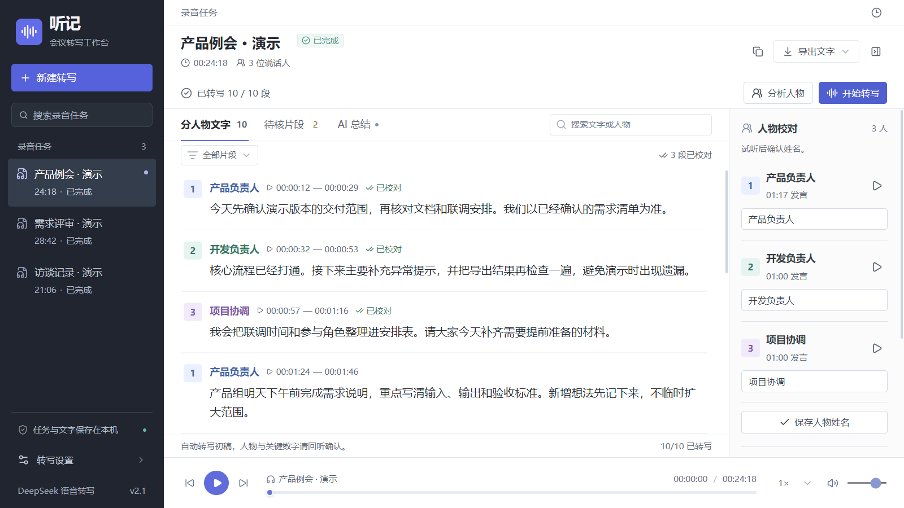
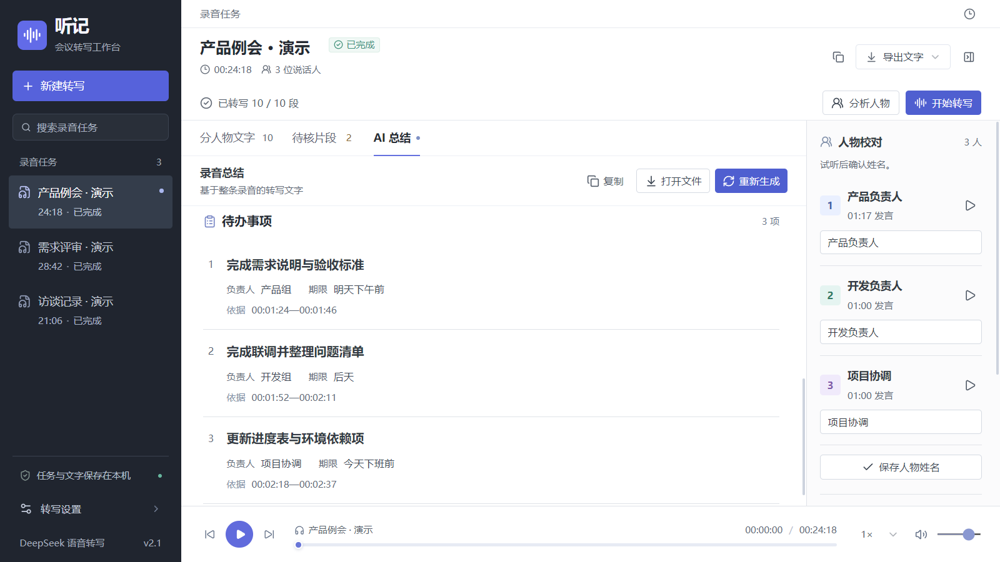
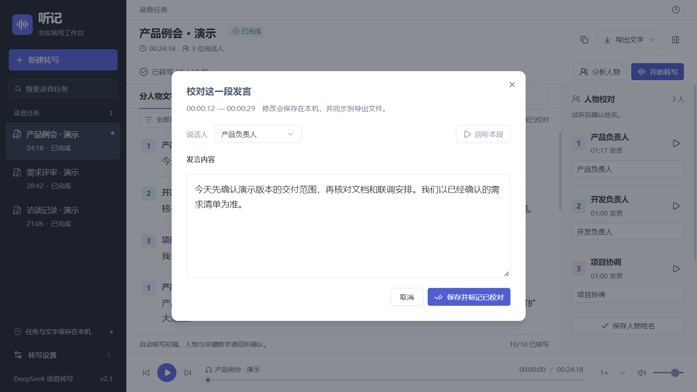

# Tingji / 听记

[简体中文](README.md) · **English**

A Windows and Android tool for meeting recordings: transcribe audio by speaker, listen back and correct the text, then generate a meeting summary with action items at the end.

The interface uses React and shadcn/ui, hosted by pywebview on Windows and Kotlin with the system WebView on Android. Speaker analysis runs locally; transcription and summaries use the DeepSeek API.

## Tingji in 38 seconds

See the workflow from importing a recording to speaker transcripts, playback review, overall and per-speaker summaries, action items and exports. This portrait (9:16) video has Chinese narration and captions. All meeting content is fictional demo data.

[▶ Watch or download the 38-second introduction (MP4)](https://github.com/TonyZhang1996/tingji/releases/download/media-2026-11-17/Tingji-introduction-38s.mp4)

## Interface preview

These screenshots show the actual Windows desktop interface with fictional meeting content, roles and action items. They do not demonstrate transcription or speaker-recognition accuracy. The interface shown is in Chinese.

### Speaker transcripts and playback

Browse speech by speaker, listen to voice samples, edit speaker names and play individual segments.



### AI summary and action items

The summary ends with action items, owners, deadlines and references to recording timestamps.



### Segment review

Listen to a segment, correct its text or speaker assignment, then mark it as reviewed.



## Features

- **Long recordings:** automatic segmentation, immediate saving of successful segments and resumable processing. Continuing a task skips segments already completed.
- **Speaker review:** consistent speaker IDs throughout a recording, voice samples, editable names and corrections to text or speaker assignments.
- **History management:** delete a task from the sidebar after confirmation. Its local transcript, corrections, summary and cache are removed; the original recording is preserved. Deletion is disabled while processing.
- **Playback and exports:** jump to a segment for review; export TXT, Markdown, JSON, CSV or a segment timeline.
- **AI summaries:** include an overall summary plus each speaker's main points, explicit commitments and recording references. Long transcripts are processed in parts and merged using current speaker labels, including labels not yet manually reviewed. Only speech without a valid speaker ID is grouped separately. Action items, owners and deadlines stay at the end. Incomplete transcripts require an explicit partial-coverage choice; regenerate older reports to add speaker summaries.

Summaries use schema-constrained output through DeepSeek Responses, with speaker IDs and names supplied by the application. Malformed completed responses stay on the local machine for offline revalidation. Requesting a failed part again requires an explicit checkbox and may incur another charge.

## Getting started

### Windows installer

Download **Tingji-Setup-2.2.0-windows-x64.exe** from [GitHub Releases](https://github.com/TonyZhang1996/tingji/releases/latest), install it and launch Tingji.

The installer supports 64-bit Windows 10/11 and runs on the CPU; a GPU or CUDA is not required. It includes Python, FFmpeg, the speaker-analysis dependencies and models, and automatically installs WebView2 when needed. No manual environment setup is required.

Transcription and summarization require an internet connection and **your own DeepSeek API key**. Charges apply to your DeepSeek account. The installer contains no personal API keys, recordings, transcripts or summaries.

The default installation folder is `%LOCALAPPDATA%\Programs\Tingji`. Tasks, audio caches, transcripts and summaries are stored in `%LOCALAPPDATA%\Tingji`. Uninstalling preserves this personal data; unwanted tasks can be deleted within Tingji. The current installer is not code-signed.

### Android prerelease

The current Android prerelease is **2.3.0-android.3**, targeting ARM64 phones such as the vivo X300. Import an existing recording through the system picker or share menu, analyze speakers locally, then call DeepSeek directly with your own API key. Models are bundled in the APK; no Python or manual model setup is needed. The interface is in Chinese.

Use the prominent “全屏阅读” action in the transcript or summary. Scrolling naturally moves task information and tools out of view; the player has an independent collapse control. Segment previews wait for seeking and stop at the selected end. First-use onboarding accepts your API key or lets you skip. Install updates over the existing app to retain tasks; do not uninstall first.

Download the [Android APK](https://github.com/TonyZhang1996/tingji/releases/download/v2.3.0-android.3/Tingji-2.3.0-android.3-arm64-v8a.apk) (about 60 MB, ARM64 devices running Android 8.0 or later). Physical vivo X300 validation is still pending. Processing time, thermals, battery use and recognition accuracy need device testing. See the [release notes](https://github.com/TonyZhang1996/tingji/releases/tag/v2.3.0-android.3) for verified results and the [Android guide](mobile/README.md#english) for use and privacy details.

**Uninstalling Android deletes app-private data.** Keep separate copies of source recordings and export important text results first. The Windows installer continues to preserve its local data on uninstall.

### Running from source

You need Windows, Python 3.11, Microsoft Edge WebView2, and `ffmpeg` and `ffprobe` available on `PATH`. Alternatively, place the FFmpeg executables in the project's `bin` directory.

After cloning or downloading the repository, open PowerShell in the project directory:

```powershell
py -3.11 -m venv .runtime
.\.runtime\Scripts\python.exe -m pip install -r requirements_desktop.txt
```

This installs only the desktop dependencies. **The speaker-analysis environment and model must be prepared separately; model weights are not included.**

Speaker analysis uses Silero VAD, CAM++ and 3D-Speaker. A compatible separate Python environment needs `torch`, `torchaudio`, `soundfile`, `silero-vad`, `onnxruntime`, `numpy` and `scikit-learn`. The 3D-Speaker directory must contain `pretrained_models/campplus/campplus_cn_en_common.pt`.

Replace these example paths with your own locations, then launch from the same PowerShell window:

```powershell
$env:MEETING_SPEAKER_PYTHON = "D:\Envs\meeting-speaker\python.exe"
$env:MEETING_SPEAKER_ROOT = "D:\Models\3D-Speaker"
.\.runtime\Scripts\python.exe -X utf8 desktop.py
```

Once the dependencies are configured, you can also use `启动工具.vbs`. Use `启动工具.cmd` to retain error messages. The repository includes `web/dist`, so Node.js is not needed for normal use.

## Workflow

Choose a recording → specify the speaker count → analyze and name speakers using voice samples → enter a DeepSeek API key and transcribe → review the recording → summarize or export.

The API key stays in the current window's memory and is not written to settings, logs or task results. ASR is charged by uploaded audio; summaries incur separate text-model charges. See [DeepSeek's pricing documentation](https://api-docs.deepseek.com/quick_start/pricing/). Requests with an uncertain outcome are not automatically resubmitted, to avoid duplicate charges.

## Privacy and limitations

Speaker analysis runs locally. Transcription sends audio segments to DeepSeek, while summarization sends transcript text and segment timestamps. Audio caches, transcripts, corrections and summaries are stored locally; the tool does not automatically upload them to GitHub.

The `.gitignore` excludes personal settings, recordings, results, caches, credential files, runtime environments and `node_modules`. Do not force-add these files, even to a private repository.

Before committing, run `.\.runtime\Scripts\python.exe scripts/check_publish.py` to check the Git index against the source allowlist and credential patterns. Add `--ref HEAD` to inspect a commit instead. The check does not print matching secrets or read ignored recordings.

Review speaker assignments, numbers and names against the recording. Timestamps identify segments rather than individual words, and overlapping speech is not separated. A partial transcript cannot support a complete recording summary. Owners or deadlines not explicitly stated are marked as unspecified.

## Development and checks

Rebuilding the interface requires Node.js and npm:

```powershell
cd web
npm ci
npm run build
```

From the project root, run the full test suite with a Python environment containing the speaker-analysis dependencies:

```powershell
& $env:MEETING_SPEAKER_PYTHON -X utf8 -m unittest discover -s tests -v
```

Automated tests cover transcription recovery, speaker clustering, summaries, history deletion and installer privacy boundaries. They use temporary synthetic audio and simulated services, with no real paid API calls. Passing these tests does not establish recognition accuracy on real recordings.

shadcn/ui component sources and third-party notices are retained in [component sources](web/COMPONENT-SOURCES.txt) and the [shadcn/ui license](web/SHADCN-LICENSE.txt).

See the [Windows packaging guide](scripts/windows/README.md) for installer build steps, pinned dependencies and publication checks.
