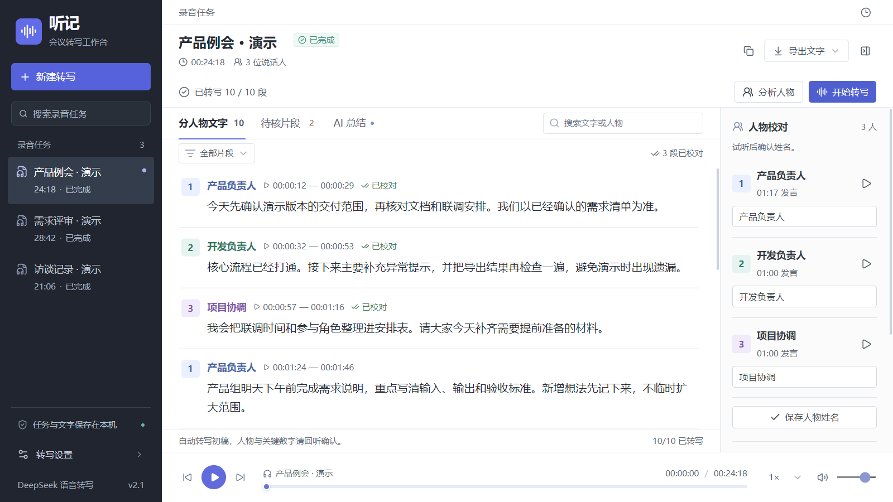
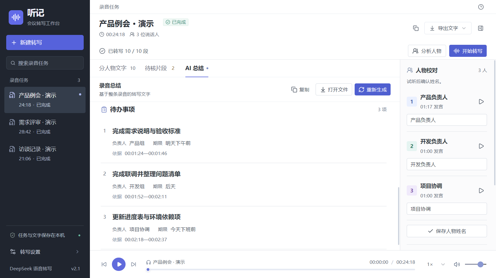
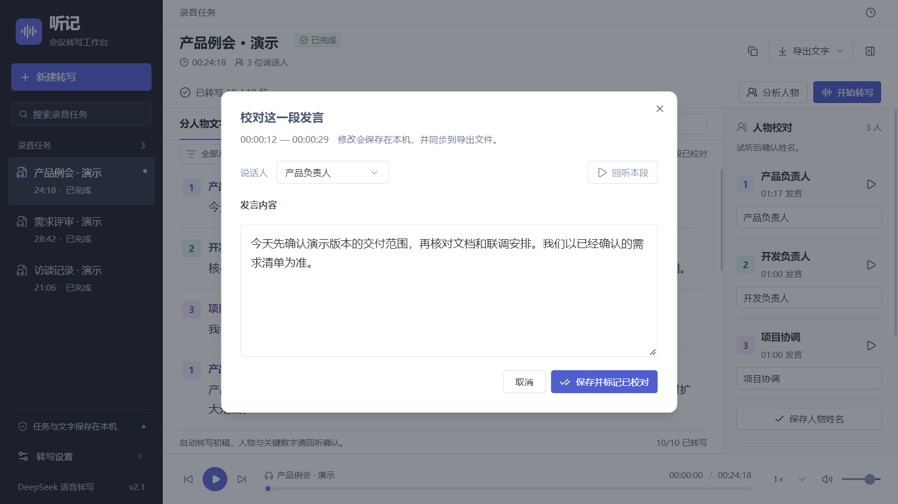

# 听记 / Tingji

**简体中文** · [English](README.en.md)

支持 Windows 和 Android 的会议转写工具：导入录音，按人物整理文字，回听校对，再生成附带待办事项的会议总结。

界面使用 React 和 shadcn/ui，Windows 由 pywebview 承载，Android 由 Kotlin 和系统 WebView 承载。人物分析在本地完成，文字转写与总结使用 DeepSeek API。

## 38 秒认识听记

从导入录音到分人物转写、回听校对、总体与逐人总结、待办和导出分享，快速了解听记的使用过程。视频为 9:16 竖屏，配中文旁白和字幕，所有会议内容均为虚构演示数据。

<video src="https://github.com/user-attachments/assets/5148c60d-25cf-4215-a14b-35efc48d28e6" controls width="360" height="640"></video>

可在播放器中开启声音。也可[下载 38 秒介绍视频（MP4）](https://github.com/TonyZhang1996/tingji/releases/download/media-2026-11-17/Tingji-introduction-38s.mp4)。

## 界面预览

以下为 Windows 桌面版真实界面截图，会议内容、人物和待办均为虚构演示数据，不代表实际转写或人物识别效果。

### 分人物转写与录音回听

按人物查看发言，试听并确认人物姓名，点击片段回听录音。



### AI 总结与待办事项

总结末尾集中列出待办事项、负责人、期限及对应的录音时间。



### 片段校对

回听单段录音，修改文字或人物归属，再标记为已校对。



## 功能

- **长录音转写**：自动分段、逐段保存、恢复进度；成功片段不会因继续转写而重新提交。
- **人物校对**：整场统一人物编号，试听声音、填写姓名、修改文字或人物归属。
- **历史管理**：在左侧任务旁点击删除，确认后清除该任务的转写、校对、总结和缓存，保留原始录音；处理过程中不可删除。
- **录音回听与导出**：点击片段跳转播放，支持 TXT、Markdown、JSON、CSV 和片段时间轴。
- **AI 总结**：同时整理总体内容和每个人的发言要点、明确承诺及录音依据；长文字分批整理后按现有人物标签合并，未人工校对的标签也会保留，仅缺少有效人物编号的发言单独列出。末尾列出待办、负责人和期限。部分转写须明确选择总结范围；旧版总结可重新生成以补齐人物总结。

总结使用 DeepSeek Responses 的结构约束输出，人物编号和称呼由程序填入。格式异常的返回仅保存在本机，下次先离线复核；需要再次请求时，须勾选“重新请求上次格式错误的部分”，可能再次计费。

## 开始使用

### Windows 安装包

从 [GitHub Releases](https://github.com/TonyZhang1996/tingji/releases/latest) 下载 **Tingji-Setup-2.2.0-windows-x64.exe**，安装后启动听记即可。

支持 Windows 10/11 64 位，使用 CPU 即可运行，无需显卡或 CUDA。安装包内置 Python、FFmpeg、人物分析依赖和模型，并在缺少 WebView2 时自动安装，无需手动配置运行环境。

转写和总结需要联网，并填写**你自己的 DeepSeek API Key**，费用从你的 DeepSeek 账户扣除。安装包不包含任何人的 API Key、录音、转写结果或总结。

默认安装位置为 `%LOCALAPPDATA%\Programs\Tingji`，任务、录音缓存、转写和总结保存在 `%LOCALAPPDATA%\Tingji`。卸载程序会保留这些个人数据，可在听记中删除不再需要的任务。当前安装包未做代码签名。

### Android 预发布版

Android 版本为 **2.3.0-android.3**，以 vivo X300 等 ARM64 安卓手机为主要适配目标。通过系统文件选择器或分享入口导入已有录音，在手机本地分析人物，再直接调用使用者自己的 DeepSeek API 转写和总结。模型随 APK 提供，无需配置 Python 或模型环境。

文字和总结页都支持醒目的“全屏阅读”，上滑时任务信息和操作区自然滚走；播放器可独立收起，片段回听在定位完成后播放并于本段末尾停止。首次使用会弹窗引导填写 API Key，也可稍后填写。更新请直接覆盖安装，保留已有任务，不要先卸载。

手机可直接[下载 Android APK](https://github.com/TonyZhang1996/tingji/releases/download/v2.3.0-android.3/Tingji-2.3.0-android.3-arm64-v8a.apk)（约 60 MB，Android 8.0 以上 ARM64 设备）。这是 Android 预发布版，尚未在 vivo X300 真机上完成验收；处理速度、发热、耗电和识别准确率需以实际测试为准。[发布说明](https://github.com/TonyZhang1996/tingji/releases/tag/v2.3.0-android.3)列出已验证结果，使用说明和隐私边界见 [Android 说明](mobile/README.md)。

**安卓卸载会删除应用私有数据**，请先另外备份原录音，并导出需要保留的文字结果。Windows 版卸载保留本地数据的行为保持不变。

### 从源码运行

需要 Windows、Python 3.11、Microsoft Edge WebView2，以及可在 `PATH` 中找到的 `ffmpeg` 和 `ffprobe`。也可把 FFmpeg 程序放进项目的 `bin` 目录。

克隆或下载仓库后，在项目目录打开 PowerShell：

```powershell
py -3.11 -m venv .runtime
.\.runtime\Scripts\python.exe -m pip install -r requirements_desktop.txt
```

以上只安装桌面界面依赖。**人物分析环境和模型需要另外准备，仓库不附带模型。**

人物分析使用 Silero VAD、CAM++ 和 3D-Speaker。兼容的独立 Python 环境需安装 `torch`、`torchaudio`、`soundfile`、`silero-vad`、`onnxruntime`、`numpy`、`scikit-learn`；3D-Speaker 目录中需有 `pretrained_models/campplus/campplus_cn_en_common.pt`。

将下面两个示例路径换成自己的位置，并从同一个 PowerShell 窗口启动：

```powershell
$env:MEETING_SPEAKER_PYTHON = "D:\Envs\meeting-speaker\python.exe"
$env:MEETING_SPEAKER_ROOT = "D:\Models\3D-Speaker"
.\.runtime\Scripts\python.exe -X utf8 desktop.py
```

依赖配置完成后，也可使用 `启动工具.vbs`；`启动工具.cmd` 会保留错误提示。仓库包含 `web/dist`，普通使用不需要 Node.js。

## 使用流程

选择录音 → 确认人数 → 分析人物并试听命名 → 填入 DeepSeek API Key 开始转写 → 回听校对 → AI 总结或导出。

API Key 仅在当前窗口内存中使用，不写入设置、日志或任务结果。ASR 按上传音频计费，总结按文字量另行计费，具体以 [DeepSeek 官方说明](https://api-docs.deepseek.com/quick_start/pricing/)为准。结果不明的请求默认不自动重发，避免重复扣费。

## 隐私与识别边界

人物分析在本地运行；开始转写会把音频片段发送至 DeepSeek，生成总结会发送转写文字与片段时间。录音缓存、转写、校对和总结保存在本机，不会由工具自动上传 GitHub。

`.gitignore` 排除个人设置、录音、结果、缓存、密钥文件、运行环境和 `node_modules`。即使使用私有仓库，也不要手动强制添加这些文件。

提交前可运行 `.\.runtime\Scripts\python.exe scripts/check_publish.py`，检查 Git 暂存内容中的文件范围和凭据特征；提交后可加 `--ref HEAD` 检查该提交。检查不会输出匹配到的密钥或读取被忽略的录音。

自动人物归属、数字和姓名仍需回听确认。片段时间不是逐字对齐，重叠讲话没有单独分离；未完成的转写不能作为整条录音的完整总结。原文未明确的负责人或期限会标为“未明确”。

## 开发与验证

重新构建界面需要 Node.js 和 npm：

```powershell
cd web
npm ci
npm run build
```

在项目根目录，使用具备人物分析依赖的 Python 运行完整测试：

```powershell
& $env:MEETING_SPEAKER_PYTHON -X utf8 -m unittest discover -s tests -v
```

自动化测试覆盖转写进度恢复、人物聚类、总结、历史删除和安装包隐私边界。测试使用临时合成音频和模拟接口，不调用真实付费 API；通过测试不代表真实录音的识别准确率。

shadcn/ui 组件的来源和第三方许可见 [组件来源](web/COMPONENT-SOURCES.txt)与 [shadcn/ui 许可](web/SHADCN-LICENSE.txt)。

Windows 安装包的构建步骤、依赖版本和发布前检查见 [安装包构建说明](scripts/windows/README.md)。
